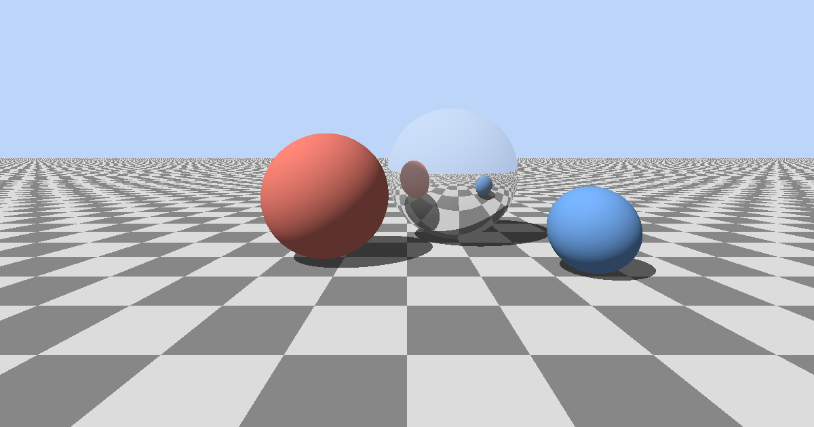
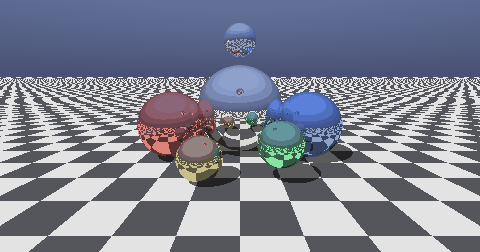

# tiny-raytracer

A ray tracer in 83 lines of Python. It uses only the standard library, writes the PNG itself with `zlib`, and needs nothing installed.



It does camera rays, ray-sphere and ray-plane intersection, Lambert shading, shadow rays and mirror reflection. The code is explained step by step in [A ray tracer in 83 lines of Python, with no dependencies](https://www.bitwiseops.com.br/blog/ray-tracer-83-lines-python).

## Run

```
python3 tracer.py 1200 630 out.png
```

The arguments are width, height and output file. At 1200 × 630 it sends 1,290,852 rays and takes about 4 seconds on one core.

## Mirrors

`mirrors.py` is the same tracer with six reflective spheres, reflections tinted by each sphere's color, up to 10 bounces and a darker sky:

```
python3 mirrors.py 1200 630 mirrors.png
```


## Real time in the browser

`web/index.html` runs the same mirrors scene in WebGL2. The tracing code is ported to a GLSL fragment shader, so the GPU traces every pixel in parallel, every frame. The small spheres bounce, the purple one orbits, and you can drag to move the camera and scroll to zoom. Open the file in any recent browser; there is nothing to install or serve.

GLSL has no recursion, so the reflection is a loop of up to 10 bounces that carries how much light is left after each mirror.



The GIF was rendered frame by frame with the Python tracer, 60 frames at 480 × 252.

## Things to change

- `SPHERES`: center, radius, color and reflectivity (0 is matte, close to 1 is a mirror).
- `LIGHT`: the direction the light comes from.
- `depth < 3` in `shade`: how many times a ray can bounce between mirrors.
