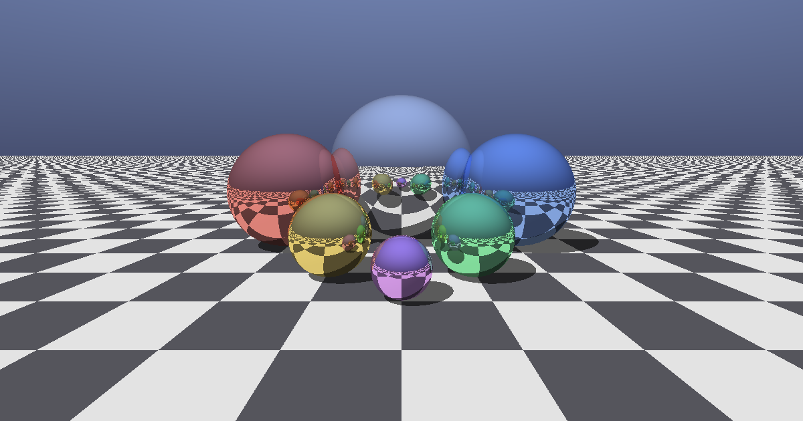

# tiny-raytracer

A ray tracer in 83 lines of Python. It uses only the standard library, writes the PNG itself with `zlib`, and needs nothing installed.


It does camera rays, ray-sphere and ray-plane intersection, Lambert shading, shadow rays and mirror reflection. The code is explained step by step in [A ray tracer in 83 lines of Python, with no dependencies](https://www.bitwiseops.com.br/blog/ray-tracer-83-lines-python).

## Run

```
python3 tracer.py 1200 630 out.png
```

The arguments are width, height and output file. At 1200 × 630 it sends 1,290,852 rays and takes about 4 seconds on one core.

## Mirrors

`mirrors.py` is the same tracer with six reflective spheres, reflections tinted by each sphere's color, up to 10 bounces and a darker sky:

```
python3 mirrors.py 1200 630 mirrors.png
```



## Things to change

- `SPHERES`: center, radius, color and reflectivity (0 is matte, close to 1 is a mirror).
- `LIGHT`: the direction the light comes from.
- `depth < 3` in `shade`: how many times a ray can bounce between mirrors.
